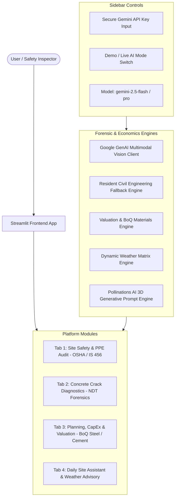

# 🏗️ Multimodal Construction Intelligence Platform
### Skill Wallet Capstone Project 1 — Autonomous Construction Safety, Structural Integrity Forensics, Real Estate Valuation & Weather-Aware Advisory

[](https://streamlit.io)
[](https://www.python.org/)
[](https://ai.google.dev/)
[](https://bis.gov.in/)

A production-ready, full-stack AI engineering platform built with Streamlit and Google Gemini. Designed for construction executives, project managers, safety inspectors, and structural forensic engineers to automate job-site risk auditing, structural pathology analysis, CapEx financial tracking, and environmental hazard mitigation.

---

## 🌟 Core Modules & Capabilities

### 1. 🦺 Tab 1: Site Safety & PPE Audit (Epic 2)
- **Computer Vision PPE Matrix:** Multimodal inspection analyzing worker compliance with:
  - Helmets / Hard Hats (`OSHA 1926.100` / `IS 2925`)
  - High-Visibility Vests (`OSHA 1926.201` / `IS 15809 Class 2`)
  - Steel-Toe Safety Footwear (`OSHA 1926.96` / `IS 15298`)
  - Fall Protection & 100% Tie-Off Harnesses (`OSHA 1926.501` / `IS 3521`)
  - Eye & Hand Protection (`OSHA 1926.102` / `IS 8519`)
- **Structured JSON Output:** Computes `safety_score` (0-100), `overall_status` (Compliant, Needs Attention, Critical Non-Compliance), worker headcount, and hazard itemization.
- **Severity-Ranked Hazard Mitigation:** Detailed site hazard cards with severity labels (`Critical`, `High`, `Medium`, `Low`), location tags, OSHA/IS standard citations, and mandatory corrective remedies.
- **Reporting:** 1-click downloads for JSON audit data and Markdown executive reports.
- **Preloaded Test Scenarios:** Instant 1-click evaluation with synthetic high-risk scaffolding violations and compliant deep trench crews.

### 2. 🧱 Tab 2: Crack Diagnostics & Structural Integrity (Epic 2)
- **Defect Pathology Classification:** Identifies structural failure modes:
  - `Structural Shear Cracks (45° Diagonal)`
  - `Foundation Differential Settlement`
  - `Concrete Cover Spalling & Corroded Rebar Oxidation`
  - `Thermal Expansion & Crazing`
  - `Superficial Plaster Drying Shrinkage`
- **Quantitative Crack Width Assessment:** Evaluates estimated fracture width (mm) against **IS 456:2000 Clause 35.3.2** limits (0.2 mm to 0.3 mm serviceability threshold).
- **Engineering Repair Protocol:** Generates technical specifications for:
  - Low-viscosity epoxy resin pressure injection (`ASTM C881 / ACI 224.1R`)
  - Carbon Fiber Reinforced Polymer (CFRP) shear strengthening (`ACI 440.2R`)
  - Hydrophobic polyurethane water-stop grouting
  - Polymer Modified Mortar (PMM) re-profiling
- **Non-Destructive Testing (NDT) Guidance:** Instructions for ultrasonic pulse velocity (IS 13311) and optical telltale monitoring.

### 3. 📊 Tab 3: Planning, CapEx & Real Estate Valuation (Epic 3)
- **Interactive Project Economics:**
  - Structure types: *Residential High-Rise (G+24)*, *Commercial IT Park*, *Industrial Logistics PEB Warehouse*, *Luxury Villa Community*, *Infrastructure/Bridge Section*.
  - Location Tiers: *Tier 1 (Mumbai, Bengaluru, Delhi NCR)*, *Tier 2 (Pune, Hyderabad, Ahmedabad, Chennai)*, *Tier 3 (Emerging Hubs)*.
  - Milestone Progress Slider (0% to 100%).
- **Financial & BoQ Calculations:**
  - Total Construction Budget (₹ Lakhs / Crores).
  - Capital Expenditure (CapEx) incurred to date with milestone stage tracking.
  - Current Market Asset Valuation (₹ Crores) based on land equity share and completed structural works.
  - Total & consumed Steel Rebar (Metric Tonnes, `IS 1786`).
  - Total & consumed Cement (50kg bags and Metric Tonnes, `IS 269 / IS 12269`).
  - Interactive Plotly visualizations for discipline cost breakdown and budget drawdown.
- **Generative 3D Conceptual Rendering (Pollinations AI):**
  - Generates photorealistic 8K architectural visual prompts mapped to building type, completion stage, and design philosophy (Biomimetic, Brutalist, High-Tech, Indo-Contemporary).
  - Embeds responsive 3D concept preview with full-resolution direct link.

### 4. 🌦️ Tab 4: Daily Site Assistant & Weather Advisory (Epic 5)
- **Meteorological Condition Engine:**
  - `High Wind (>40 km/h)`: Tower crane shutdown, slew brake weathervane mode (`IS 13367 / OSHA 1926.1431`), scaffolding evacuation.
  - `Heavy Rain / Monsoon`: Pour postponement, dewatering sump pumps, 30mA RCD electrical breaker isolation.
  - `Extreme Heat (>42°C)`: Chilled water batching, liquid curing compound + saturated hessian ponding (`IS 456 / ACI 305R`), worker hydration breaks.
  - `Normal / Clear`: Full production clearance and 7-day OPC curing adherence.
- **SiteMind Engineering Assistant Chatbot:**
  - Multi-turn conversational civil engineer with persistent memory (`st.session_state`).
  - Deep technical knowledge of IS 456, IS 800, IS 1893, NBC 2016, and OSHA.
  - 1-click quick inquiry chips for M25 mix design, tower crane wind limits, deshoring periods, and excavation shoring.

---

## 🛠️ Architecture & Tech Stack



- **Frontend & App Framework:** Streamlit (Python 3.10+)
- **Multimodal AI:** Google GenAI SDK (`gemini-2.5-flash`, `gemini-2.5-pro`)
- **Data Visualization:** Plotly Graph Objects & Express
- **Image Processing & Synthesis:** Pillow (PIL)
- **Conceptual 3D Visualizer:** Pollinations AI Generative Image API
- **Database Dependencies:** **Zero external DB dependencies** (all session state is managed natively in-memory for 1-click cloud deployment).

---

## 🚀 Quickstart & Local Installation

### 1. Clone the repository
```bash
git clone https://github.com/your-username/multimodal-construction-platform.git
cd multimodal-construction-platform
```

### 2. Install dependencies
```bash
pip install -r requirements.txt
```

### 3. Launch the Streamlit application
```bash
streamlit run app.py
```
The application will launch automatically at `http://localhost:8501`.

---

## 🔑 Gemini API Key Configuration & Graceful Fallback

1. **Option A (In-App):** Enter your Gemini API Key in the left sidebar under the masked password field.
2. **Option B (Environment Variable):**
   ```bash
   export GEMINI_API_KEY="your-gemini-api-key-here"
   streamlit run app.py
   ```
3. **Option C (Zero-Key Demonstration Mode):**
   If no API key is provided, or if the "Run in Offline Demonstration Mode" checkbox is enabled, the platform **gracefully falls back** to the resident civil forensic models. Every tab, file uploader, test scenario, BoQ calculation, and chatbot feature remains 100% interactive!

---

## ☁️ 1-Click Deployment to Streamlit Community Cloud

1. Push this folder to a GitHub repository.
2. Log in to [share.streamlit.io](https://share.streamlit.io).
3. Click **"New App"** and select your repository.
4. Set the Main file path to: `app.py`.
5. *(Optional)* Add your `GEMINI_API_KEY` under **Advanced Settings > Secrets**:
   ```toml
   GEMINI_API_KEY = "your-api-key"
   ```
6. Click **Deploy!**

---

## 📄 License & Academic Attribution
Developed as **Capstone Project 1 (Skill Wallet)** under Advanced AI Engineering principles.
Compliant with OSHA 1926 Safety & Health Regulations and Bureau of Indian Standards (BIS) Civil Engineering Codes.
